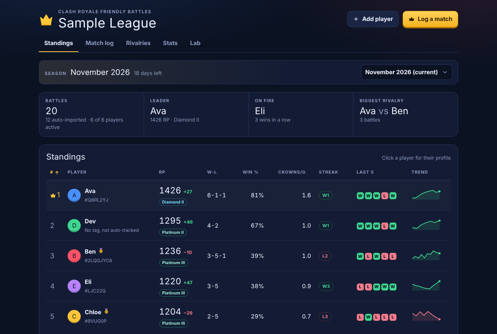
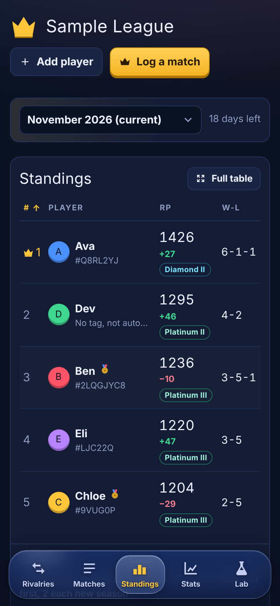
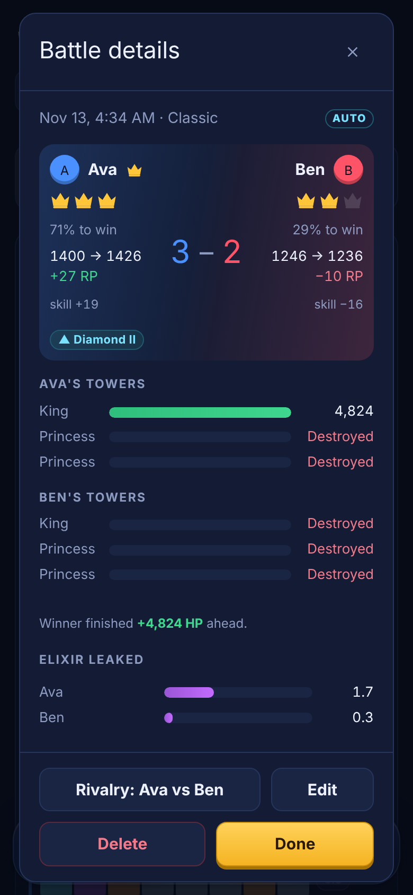
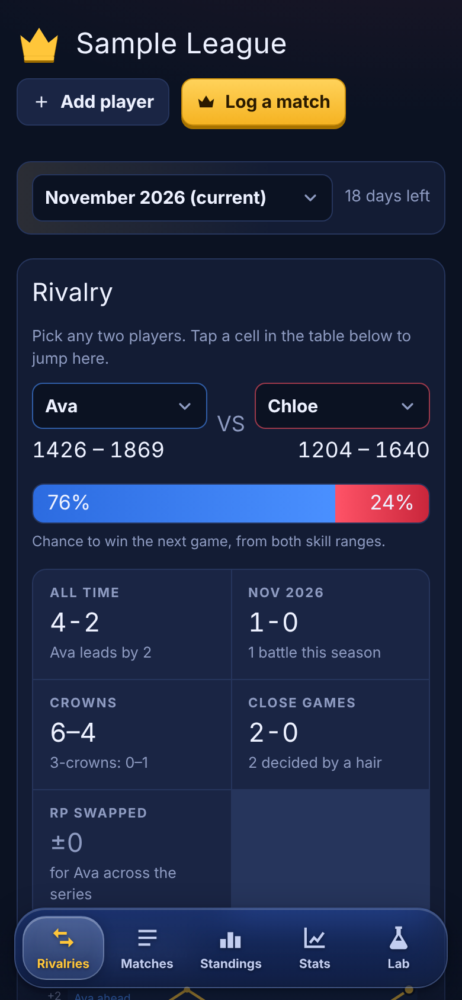
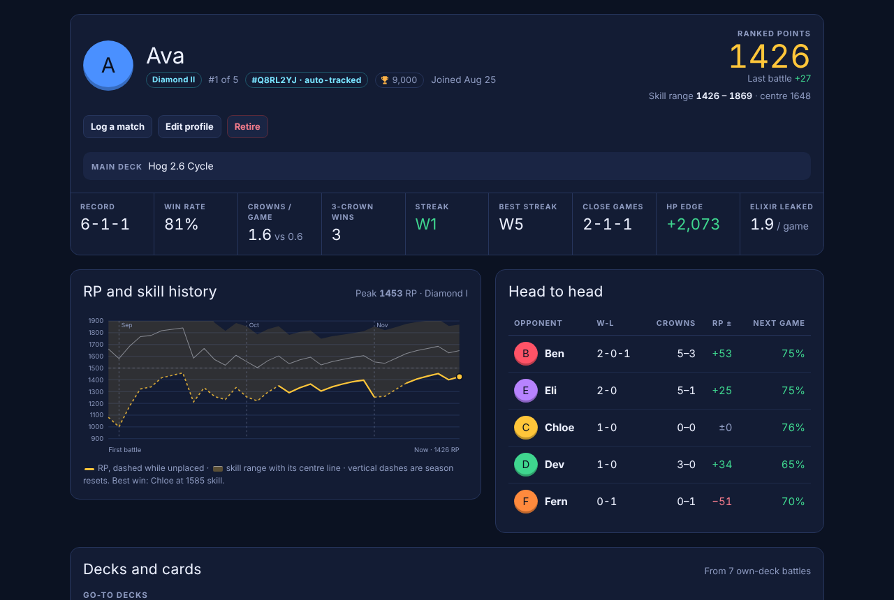
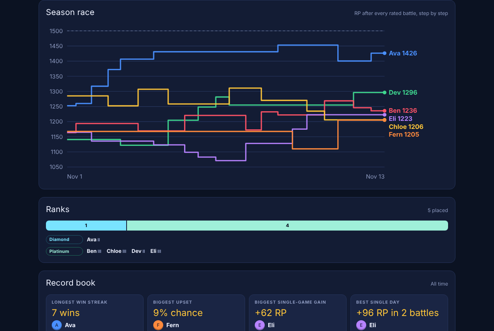
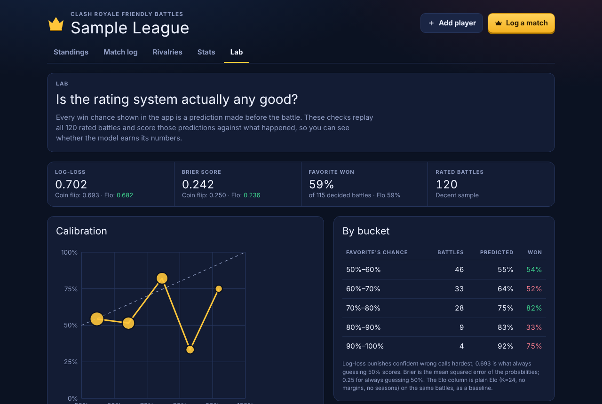

# CR Friends League

A ranked ladder for Clash Royale **friendly battles**. Friendlies don't count for anything in the game, so this app pulls them straight from the official Clash Royale API, rates every battle, and runs monthly ranked seasons for a group of friends, complete with ranks, divisions, placements and a champion at the end of each month.

It's a small Node server plus a dependency-free vanilla JS front end, deployed on Railway as an installable home-screen app.

<p>
  
  
</p>

## Features

- **Automatic match tracking.** Every few minutes the server reads each player's battle log, keeps 1v1 friendlies between league members, and stores crowns, decks, tower HP and elixir leaked. The same battle seen from both players' logs is stored once, and hand-logged matches are merged with their imported copy instead of doubled.
- **Ranked Points, ranks and placements.** A hidden Glicko-2 skill rating drives a public RP number and a rank from Wood III to Champion. New players go through placements before they get a rank (see [how ranking works](#how-ranking-works)).
- **Monthly seasons** with a soft reset, a champion, and a welcome screen that crowns last month's winner.
- **Player profiles** with RP and skill history, peak rank, head-to-heads, record by game mode, and deck and card stats.
- **Rivalries.** Pick any two players for their head-to-head record, the chance to win the next game, series momentum and deck matchups.
- **Stats.** The season's RP race, a rank distribution, a record book, clutch and tilt stats, elixir leaked, the league's deck meta, when people play, and a weekly recap image you can share to a group chat.
- **Lab.** Replays every rated battle to score the model's win predictions (log-loss, Brier, calibration) against a coin flip and plain Elo, and grid-searches the rating settings on a held-out test set.
- **"This is me."** Each phone remembers who its owner is, highlights their row, and opens with what changed since their last visit.
- **Mobile first.** It installs to the home screen and has a frosted bottom tab bar you can drag between tabs, page transitions, and a full-table view for the standings on small screens.

<p>
  
  
  
</p>

## How ranking works

Each player has two numbers.

**Skill** is a [Glicko-2](http://www.glicko.net/glicko/glicko2.pdf) rating. Everyone starts at 1500 with a rating deviation (RD) of 350. RD is how unsure the system is: it shrinks as you play and grows while you're away. Skill is hidden in most of the app. Profiles show it as a **skill range**, skill ± 2·RD, where the system thinks your true skill sits.

**Ranked Points (RP)** are the bottom of that range:

```
RP = skill − 2 × RD
```

That's the skill the system is about 95% sure you have. Standings, ranks and champions all use RP, so a lucky 3-0 start can't top the table until it holds up, while a real hot streak against strong players still climbs fast.

A few extras sit on top of plain Glicko-2:

- **Crown margin.** Against an even opponent, a 2-crown win moves skill 1.15× as much as a 1-crown win and a 3-crown win 1.3×. The bonus grows for underdog wins and shrinks when a heavy favorite stomps a weaker player.
- **Tiebreakers.** When crowns are level, the winner is decided from the remaining tower HP in the battle log, like the in-game rule.
- **Placements.** Until RD drops to 130 a player is *unplaced*: no RP, no rank, listed under the standings with an estimate of the battles left (about 7 the first time). After 3 battles they get a *projected* rank.
- **Seasons.** On the 1st of each month skill moves halfway back to 1500 and RD rises to at least 150, so everyone replays about 2 placement battles. The most RP at month's end (placed, 5+ battles) is crowned champion.
- **Inactivity.** RD grows while you don't play, so RP slowly drifts down until you're back.

**Ranks** are 150 RP wide, each split into three 50-RP divisions (III, II, I):

| Rank | RP |
|---|---|
| Champion | 1500+ |
| Diamond | 1350 – 1499 |
| Platinum | 1200 – 1349 |
| Gold | 1050 – 1199 |
| Silver | 900 – 1049 |
| Bronze | 750 – 899 |
| Wood | below 750 |

Nothing is stored as a rating. The whole league is recalculated from the match history whenever it changes, so fixing or deleting an old match corrects everything after it.

<p>
  
  
</p>

## Engineering notes

- **One rating engine for the browser and the tests.** `public/rating.js` and `public/stats.js` are plain ES modules with no DOM access. The UI imports them directly and `node:test` tests them, so there's no build step and no second copy of the math.
- **Derived, not stored.** The server stores players and matches only. Ratings, seasons, records and every chart are pure functions of that history, memoized per data version on the client.
- **Honest model evaluation.** The Lab backtests the exact pre-game win probability shown for every battle and checks calibration, with plain Elo as a baseline. The tuner fits on the oldest 70% of battles and scores on the newest 30%.
- **Polling the battle log safely.** The API only keeps the last 25 battles, so the poller runs in the web process on a fixed interval, dedupes on a deterministic battle key, remembers deleted imports so they don't come back, and fills in decks and stats for older imports when it sees them again.
- **Small attack surface.** Viewing is public. Edits need a shared league password, compared as a hash with `timingSafeEqual`. All input is validated server-side.

## Tech

Node 22 (`node:http`, ES modules) · PostgreSQL via `pg` (the only runtime dependency) · vanilla JS, HTML and CSS with no framework or build step · Glicko-2 · Clash Royale API via the RoyaleAPI proxy · Railway · PWA (manifest, home-screen icons, Open Graph previews) · `node:test`.

```
cr-league/
  public/            the app (served as static files)
    app.js           views, routing, charts, dialogs, tab bar
    rating.js        Glicko-2, crown margins, seasons, RP, ranks, placements, card stats, backtesting
    stats.js         Stats and Lab analytics: records, clutch, tilt, meta, recap, calibration, tuning
  src/
    server.js        HTTP server, REST API, static files
    poller.js        battle log polling, dedupe, merging with hand-logged matches
    battles.js       pure parsing of battle log entries
    store-pg.js      Postgres storage (tables created on boot)
    store-memory.js  in-memory storage for local dev and tests
  test/              36 unit and end-to-end tests, including a full sync against a fake CR API
```

## Run it

```bash
cd cr-league
npm install
cp .env.example .env   # add a Clash Royale API key and a league password
npm run dev            # http://localhost:3000, in-memory unless DATABASE_URL is set
npm test
```

With no players yet, the app offers **Preview with sample data**, which is where the screenshots above come from.

Deploying to Railway, the API key setup, and every setting are covered in [`cr-league/README.md`](cr-league/README.md).
